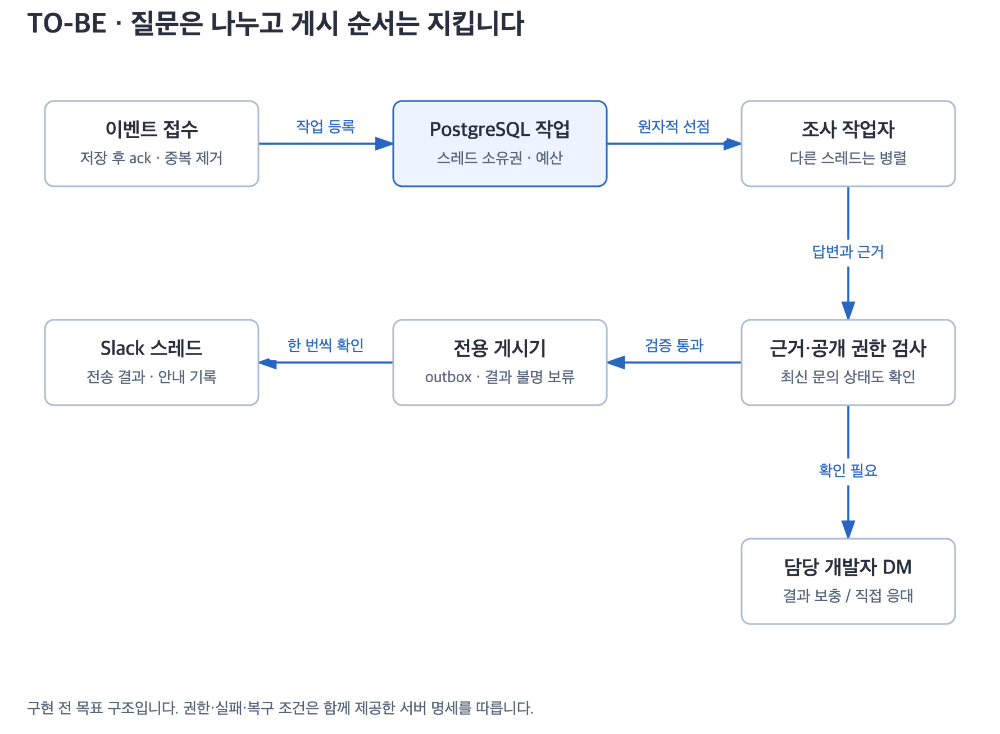

# 구조와 코드 경계

[서버 설계 입구](README.md) · 다음: [지식 공유·갱신](knowledge.md)

## 현재 코드에서 출발하기

아래 분석의 기준은 [216ed14](https://github.com/thisisnew/dougle/tree/216ed14)입니다. 스킬 0.8.17 / 봇 0.1.14의 로컬 구조를 확인했습니다.

| 현재 코드 | 확인한 동작 | 서버 변경 |
|---|---|---|
| [runtime.py](../../dougle-bot/src/dougle_bot/runtime.py) | Apple Silicon 검사, 로컬 프로세스 잠금, Socket Mode, 조사 루프 1개 | 실행 환경 선택, 서비스 역할 분리, 작업자 풀 |
| [config.py](../../dougle-bot/src/dougle_bot/config.py) | `max_parallel` 기본·허용값 1 | 서버 설정에서 동시성·조회별 제한 |
| [engine.py](../../dougle-bot/src/dougle_bot/engine.py) | CLI 실행, 외부 세션, 도구·스킬 실행 기록 수집 | 엔진 계약 확장, 격리된 작업 디렉터리 |
| [secrets.py](../../dougle-bot/src/dougle_bot/secrets.py) | `SecretStore`와 Mac 키체인 구현 | 회사 시크릿 저장소용 구현 |
| [store.py](../../dougle-bot/src/dougle_bot/store.py) | SQLite WAL, 프로세스 내 잠금, 작업·게시 기록, 독립 전송 원장 | 저장소 인터페이스와 PostgreSQL 구현 |
| [worker.py](../../dougle-bot/src/dougle_bot/worker.py) | 조사·검증·진행·카드·자동 게시 연결 | 조사, 상태 전이, 게시 예약 책임 분리 |
| [actions.py](../../dougle-bot/src/dougle_bot/actions.py) | 결과 입력, 직접 응대, 승인 경계, 조건부 게시 | 동일 전이를 서버 트랜잭션으로 구현 |
| [evidence.py](../../dougle-bot/src/dougle_bot/evidence.py) | 필요한 읽기와 실제 성공 기록 대조 | 실행기와 무관한 공통 검증 계약 유지 |

`ThreadPoolExecutor(max_workers=4)`는 사용자 상호작용 처리용입니다. AI 조사 4건 병렬 구현으로 해석하지 않습니다. `store.recover()`도 단일 실행기 전제이므로 여러 작업자 시작 시 그대로 호출하면 안 됩니다.

## 실행 역할



[그림 확대](diagrams/runtime.svg)

| 역할 | 입력 | 책임 | 외부 쓰기 |
|---|---|---|---|
| 수신기 | Slack 이벤트·상호작용 | 앱·워크스페이스 검증, 중복 제거, 접수 저장, ack | 없음 |
| 조사 작업자 | 선점한 작업과 질문 문맥 | 지식 탐색, 원본 조회, 답변 후보·근거 생성 | 개인 작업 공간만 |
| 검증기 | 후보, 실행 기록, 정책 | 조사 의무·근거 일치·공개 가능 범위 검사 | 없음 |
| 게시기 | 전송 대기 기록 | 최종 권한 확인, Slack 전송·결과 기록 | Slack API만 |
| 지식 갱신기 | 공유 커밋·검증된 수정 제안 | 변경분 병합, 새 지식 버전 활성화 | 서버 지식 사본만 |
| 복구기 | 만료 작업·불명 전송 | 살아 있는 소유자 확인, 안전한 재개·보류 | 상태 기록만 |

각 역할은 모듈 또는 프로세스입니다. 첫 배포부터 별도 서버가 필요한 것은 아닙니다. 하나의 컨테이너 이미지에서 역할을 선택해 실행하고 같은 PostgreSQL을 사용합니다. 스케줄러가 여러 인스턴스를 띄워도 수신기·게시기의 활성 소유권은 DB로 제한합니다.

Slack 토큰은 수신·게시 구성에만, DB 조회 인증은 조회 연결에만 전달합니다. 조사 작업자가 봇 토큰·시크릿 저장소 전체를 읽을 수 있게 환경변수나 공용 홈을 넘기지 않습니다.

## 목표 코드 배치

아래는 새로 만들 경로입니다. 기존 파일을 한 번에 이동하지 않고 계약을 추출한 뒤 호출자를 단계적으로 바꿉니다.

```text
skills/                         기존 호스트 스킬 정본
plugins/dougle/skills/           배포 사본
dougle-bot/src/dougle_bot/
  application/                  접수·조사·검증·인계·게시 유스케이스
  contracts/                    저장소·엔진·지식·조회·권한 계약
  adapters/
    sqlite/                     로컬용
    postgres/                   서버용
    claude_cli/                 기존 실행기
    claude_sdk/                 수용 검증 후 도입할 서버 실행기
    slack/                      현재 Bolt 연결 재사용
    secrets/                    Keychain / 회사 저장소
    sources/                    코드·문서·BigQuery·승인된 운영 조회
  entrypoints/
    local.py                    기존 CLI·스킬 메뉴 유지
    server.py                   역할별 실행·종료·상태 확인
deploy/                         컨테이너·설정 예시·운영 절차
tests/contracts/                모든 구현이 공유하는 동작 검사
tests/server/                   실제 PostgreSQL·병렬·복구 검사
```

서버용 추가 의존성은 선택 설치 묶음으로 둡니다. PostgreSQL 드라이버, 선택한 시크릿 연결, Agent SDK의 버전과 목적을 기록합니다. 스킬 사용자와 기존 로컬 봇에 서버 의존성을 강제하지 않습니다.

## 공통 인터페이스

인터페이스는 예외를 숨기는 포장으로 끝내지 않습니다. 아래 결과와 실패 이유를 구조화해 호출자가 다음 행동을 결정할 수 있어야 합니다.

| 계약 | 필요한 연산·결과 |
|---|---|
| `InquiryStore` | `accept_event`, `claim_job`, `renew_lease`, `complete_job`, `apply_developer_action`, `reserve_delivery`; 전이·감사·다음 작업은 같은 트랜잭션 |
| `Engine` | `run(context, tool_policy, budget, cancellation, progress)`; 답변 후보, 세션 참조, 실제 도구·스킬 실행 기록, 비용, 근거 영수증 반환 |
| `KnowledgeStore` | `pin_snapshot`, `search`, `read`, `propose_patch`, `activate`; 검색·읽기에 `AccessContext` 필수 |
| `SourceReader` | `capabilities`, `revision`, `schema`, `read`, `query`; 자료 식별자·버전·범위·관측 시각·잘림 여부 반환 |
| `Authorization` | `authorize_read`, `authorize_delivery`; 정책 버전과 허용/거절 이유 반환 |
| `SecretProvider` | 이름으로 자격 조회, 만료·회전 처리; 값은 로그·오류·엔진 출력에 포함하지 않음 |
| `SlackGateway` | 이벤트, 스레드·파일 읽기, 메시지·반응 전송; 확정 실패와 결과 불명을 구분 |
| `Clock` | 테스트용 시각과 실제 시각; 작업 소유권 판정은 DB 시각 사용 |

`AccessContext`는 서버가 만든 `workspace_id`, `channel_id`, `requester_id`, `allowed_domains`, `policy_version`입니다. 질문 본문이나 가져온 문서가 이를 바꿀 수 없습니다. 조회 연결은 모델이 넘긴 채널·계정을 신뢰하지 않고 실제 문의와 다시 연결합니다.

## AI 실행 환경

첫 단계에서는 기존 CLI 어댑터로 서버 인증·읽기·실행 기록을 검증합니다. Agent SDK로 교체할 때도 세션 파일과 작업 디렉터리의 수명은 관리해야 합니다. SDK 자체가 상태 없는 HTTP 호출이 되는 것은 아닙니다. [공식 호스팅 설명](https://code.claude.com/docs/en/agent-sdk/hosting)

질문마다 격리된 임시 디렉터리를 주고 지식 버전과 필요한 원본만 읽기 전용으로 연결합니다. 기존 `~/.dougle/` 경로가 필요한 스킬은 서버 전용 홈에 고정된 스냅샷을 연결합니다. 정정·갱신은 작업별 overlay에 쓰게 하고 종료 시 수정 제안으로 추출합니다. 원본 저장소·다른 질문·서버 설정에는 쓰지 못합니다.

필수 스킬 `dougle-ask`, `i-have-adhd`, `plain-language`는 버전을 고정합니다. 실행기 교체 시 성공 기록 수집·검사도 재현합니다. “프롬프트에 같은 설명을 넣었음”을 스킬 실행 성공으로 치환하지 않습니다. 표현 단계 때문에 재조사를 반복하지 않도록 이미 허용된 동일 문의의 근거 재사용 경계는 보존합니다.

개인 CLI 구독·SSO를 복사하지 않습니다. 회사가 승인한 과금 계정·서비스 인증과 자료 전송 범위를 정하고 운영합니다. 모델 이름·가격·인증 방식은 배포 시 공식 문서와 계약을 다시 확인합니다.

## 배포 단위와 확장

첫 서버는 수신기 1개, 게시기 1개, 조사 동시 2건, 갱신기 1개로 시작합니다. 이 수는 논리 역할 수이며 서버 대수는 아닙니다. CPU·메모리 크기는 격리 CLI 2건과 실제 자료를 사용한 측정 후 정합니다.

확장 시 병목을 기준으로 조사 작업자를 늘립니다. 대기열·권한·비용·스레드 소유권은 DB에서 관리하므로 동일 질문을 여러 작업자가 맡지 않습니다. 읽기 연결별 제한은 전체 작업자 수와 별개입니다. 운영 DB에는 동시 1건만 허용하면서 문서 질문은 병렬 처리할 수 있습니다.

여러 워크스페이스를 지원할 때를 위해 키에 `workspace_id`를 포함합니다. 첫 서버의 지원 범위는 회사 워크스페이스 하나이며 다중 테넌트 서비스 운영을 완료했다고 표시하지 않습니다.
