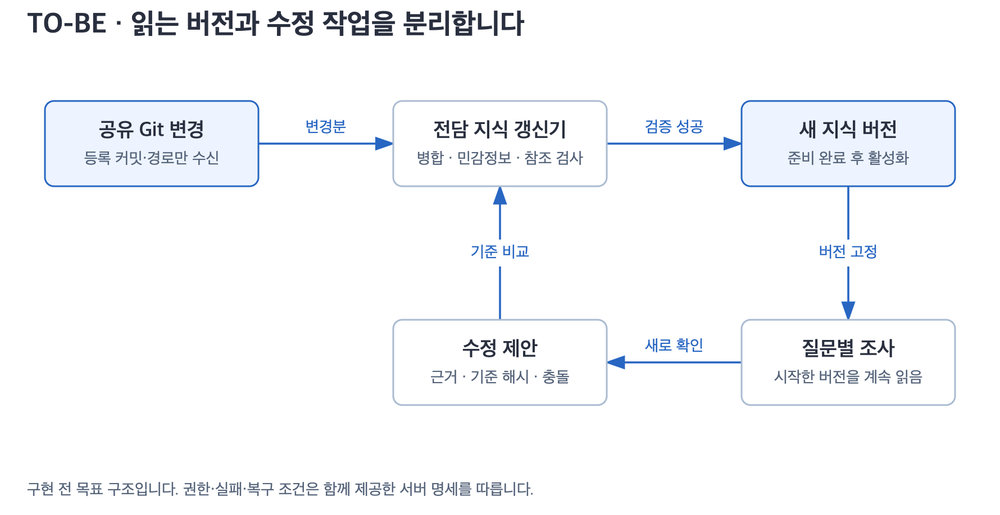

# 지식 공유·갱신

[서버 설계 입구](README.md) · 다음: [문의 처리·데이터 모델](runtime.md)

## 네 가지 작업의 경계

| 작업 | 주체 | 읽는 곳 | 쓰는 곳 |
|---|---|---|---|
| connect | 개발자의 로컬 AI | 허용된 원본 | 개인 지식 |
| publish | 공유를 요청받은 로컬 AI | 선택한 개인 지식과 원격 변경 | 지정 Git 저장소·범위 |
| fetch | 로컬 AI 또는 서버 동기화기 | 등록한 공유 저장소 | 각자의 지식 사본 |
| 질문 시 확인 | 로컬 AI 또는 서버 조사 작업자 | 필요한 원본·현재 데이터 | 문의 근거, 필요한 지식 수정 제안 |

서버 자동 수신은 등록 저장소·브랜치·경로에 대한 별도 설정입니다. 개인 fetch의 명시적 요청 동작을 바꾸지 않습니다. 서버의 Git 읽기 자격에는 push 권한을 주지 않습니다. 서버가 새로 확인한 내용을 공유하려면 정제한 변경 묶음을 내보내고 기존 publish 절차를 거칩니다.

## 지식 버전 만들기



[그림 확대](diagrams/knowledge.svg)

스냅샷은 질문이 읽는 변경 불가능한 지식 묶음입니다. 원본 Git 커밋, 서버 수정 이력, 정책 범위를 기록합니다. 활성 스냅샷의 파일을 제자리에서 고치지 않습니다.

1. 동기화기는 등록 ref의 커밋을 비교합니다. Git webhook은 변경 신호로만 사용하며 실제 커밋·권한은 등록 원격에서 확인합니다.
2. 원격 커밋을 고정하고 지난 성공 커밋과 변경 파일 목록을 구합니다. 큰 변경은 상한이 있는 배치로 처리합니다.
3. 안전한 임시 경로에서 파일 형식, 경로 탈출·symlink, 크기, 민감정보, 출처 관계와 공유 범위를 검사합니다. 저장소의 스크립트·Git hook은 실행하지 않습니다.
4. 공통 기준, 새 원격 내용, 서버 수정분을 비교해 병합합니다. 의미 충돌을 모델로 해결해야 하면 이 단계의 작업으로 분리하고 비용·완료 지점을 기록합니다.
5. 토픽·소스·정정·충돌을 보존하고 바뀐 항목의 검색 메타데이터를 만듭니다. 증거가 없는 충돌 해결이나 최신 작성자 우선 덮어쓰기는 금지합니다.
6. 새 버전 전체의 참조 무결성을 확인합니다. 기존 내용의 해시가 같으면 검사 결과를 재사용하되 검사기·정책 버전도 같아야 합니다.
7. DB 트랜잭션으로 활성 스냅샷 포인터를 바꿉니다. 파일·목록·검색 준비가 모두 끝나기 전에는 활성화하지 않습니다.
8. 실패하면 이전 활성 버전을 유지합니다. 처리한 커밋·경로·해시·남은 범위를 체크포인트로 보관합니다.

원격 force-push로 공통 조상을 잃으면 단순 차이 적용을 중단하고 파일 해시 목록을 비교해 재조정합니다. 원격 삭제는 개인 정정·근거의 즉시 삭제로 처리하지 않습니다. 삭제 근거와 정책에 따라 사용 중단 표시를 하고 충돌을 남깁니다. 보안상 접근 철회는 다음 절의 권한 규칙으로 즉시 차단합니다.

실행 중인 문의는 시작 시 고정한 스냅샷을 계속 읽습니다. 다만 권한 철회·민감정보 발견은 버전 고정보다 우선하며 조회와 게시를 차단합니다. 자료 갱신 성공을 “모든 원본을 지금 확인함”으로 기록하지 않습니다.

## 서버에서 새로 배운 내용

질문 조사 결과의 `propose_patch`에는 아래 필드가 필요합니다.

```text
proposal_id, workspace_id, domain_id, base_snapshot_id
topic_ids, source_ids, claim_ids, expected_content_hashes
replacement_or_addition, evidence_receipt_ids, source_revisions
conflicts, sensitivity_result, created_by_run_id
```

갱신기 하나가 기준 해시를 확인한 뒤 적용합니다. 기준이 달라졌으면 최신 버전에 재병합하고 충돌을 보존합니다. 실패한 수정 제안은 완료로 표시하지 않습니다. 같은 제안 ID는 한 번만 적용합니다.

운영 DB 원시 행, 첨부 이미지, 전체 채팅, 개인 식별 정보는 공통 지식에 넣지 않습니다. 여러 질문에 쓸 수 있는 업무 의미·조건·출처만 정제합니다. 개인정보 검사 통과만으로 공유 권한이 생기지는 않습니다.

## 질문마다 무엇을 확인하나요?

기존 [freshness 계약](../../skills/dougle-ask/references/freshness.md)을 유지합니다.

| 질문 | 확인 |
|---|---|
| 업무 개념·일반 절차 | 목차·토픽으로 찾고 필요한 원본 버전·내용을 확인 |
| 실제 코드 동작 | 설정된 원격 ref와 관련 코드·호출·조건·예외 조사 |
| 현재 건수·상태·운영 설정 | 해당 의미를 보장하는 최신 읽기 조회 |
| 과거 특정 시점 | 그 시점에 해당하는 자료와 관측 범위 |
| 내용 충돌·부족 | 관련 원본 조사 확대 또는 내부 확인 요청 |

기본은 관련 질문마다 변경 확인입니다. 사용자가 지정한 주기는 보존하되 현재값·실제 구현 조사·충돌 등의 우선 조건은 그대로 적용합니다. 변경이 없고 근거가 충분하면 토픽을 다시 쓰지 않습니다. 갱신 실패 시 마지막 성공 시각을 전진시키지 않습니다.

권한이 같고 원본·버전·범위가 같은 동시 확인은 하나의 읽기 작업으로 합칠 수 있습니다. 각 문의에는 그 결과와 실제 관측 시각을 연결합니다. 현재 상태 조회는 질문별 허용 지연을 충족할 때만 공유하며 출처가 다른 질문의 성공 기록을 재사용하지 않습니다. 필수 스킬 실행은 문의별 엔진 호출에서 유지합니다.

## 검색과 큰 자료 묶음

검색 순서는 `목차·메타데이터 → 관련 토픽·조건·예외 → 소스 → 필요한 원문`입니다. 관련성이 낮은 문서를 프롬프트에서 제외하되 질문에 필요한 의존 관계까지 자르지 않습니다.

초기 검색은 기존 파일 기반 탐색을 사용합니다. 서버에서 다음 항목을 따로 측정합니다.

- 후보 검색 시간과 읽은 파일·바이트 수
- 원본 버전 확인·본문 읽기·운영 조회 시간
- AI 입력·출력 토큰과 작성 시간
- 동기화 검사·병합·활성화 시간

증분 목록은 `path, content_hash, topic_id, source_id, domain_id, source_revision`을 포함합니다. 실행기 설치 때 지식 전체를 스캔하지 않습니다. 같은 커밋을 다시 받으면 의미 병합·전체 파일 재검사를 하지 않습니다. 최초 동기화는 전체 비용이 들며 자료가 많을수록 시간이 늘어납니다. 이 비용을 0으로 표현하지 않습니다.

검색용 SQLite·PostgreSQL 색인이나 임베딩은 실측 병목이 확인된 후 별도 결정합니다. 도입하더라도 Markdown에서 다시 만들 수 있는 파생물이며 publish/fetch 대상에서 제외합니다. 파일 수만으로 더 빠르다고 단정하지 않습니다.

## 갱신 이력과 삭제

내용 해시가 같은 파일은 같은 저장 객체를 참조할 수 있습니다. 스냅샷마다 전체 복사본을 만들거나 토픽을 끝없이 append하지 않습니다. 현재 버전·이전 복구 버전·실행 중 문의가 참조하는 버전만 보관하고 보관 정책에 따라 나머지를 정리합니다.

참조 수 감소와 제거는 트랜잭션으로 조정합니다. 재시작한 작업이 참조할 버전을 먼저 지우면 안 됩니다. 출처 삭제·보존 만료·개인정보 삭제 요청은 파일뿐 아니라 검색 색인·캐시·첨부·세션 파일·백업 정책까지 추적합니다. Git 이력에 민감정보가 들어간 경우 단순 새 커밋 삭제로 해결됐다고 판단하지 않습니다.

## 동기화 기록 계약

| 기록 | 필수 내용 |
|---|---|
| `knowledge_repositories` | 저장소 ID, 원격, ref, 허용 경로, 도메인, 마지막 성공 커밋, 상태 |
| `knowledge_snapshots` | ID, 원격 커밋 목록, overlay revision, manifest hash, 검사기·정책 버전, 상태 |
| `knowledge_files` | 스냅샷, 상대 경로, 내용 해시, 토픽·소스 ID, 접근 범위 |
| `refresh_jobs` | 원본·범위·기준 버전, 소유권, 체크포인트, 시도·성공 시각 |
| `knowledge_proposals` | 수정 제안, 기준 해시, 근거, 병합 결과·충돌, 적용 스냅샷 |

여러 저장소를 한 지식 버전에 묶으면 저장소별 커밋을 모두 기록합니다. 전부 같은 시점의 자료라고 표시하지 않습니다. 저장소 A의 실패가 무관한 B의 정상 자료까지 차단할지는 도메인 의존 관계로 결정합니다. 실패한 자료가 필요한 답변에는 확인 범위가 부족하다는 사실을 남깁니다.
