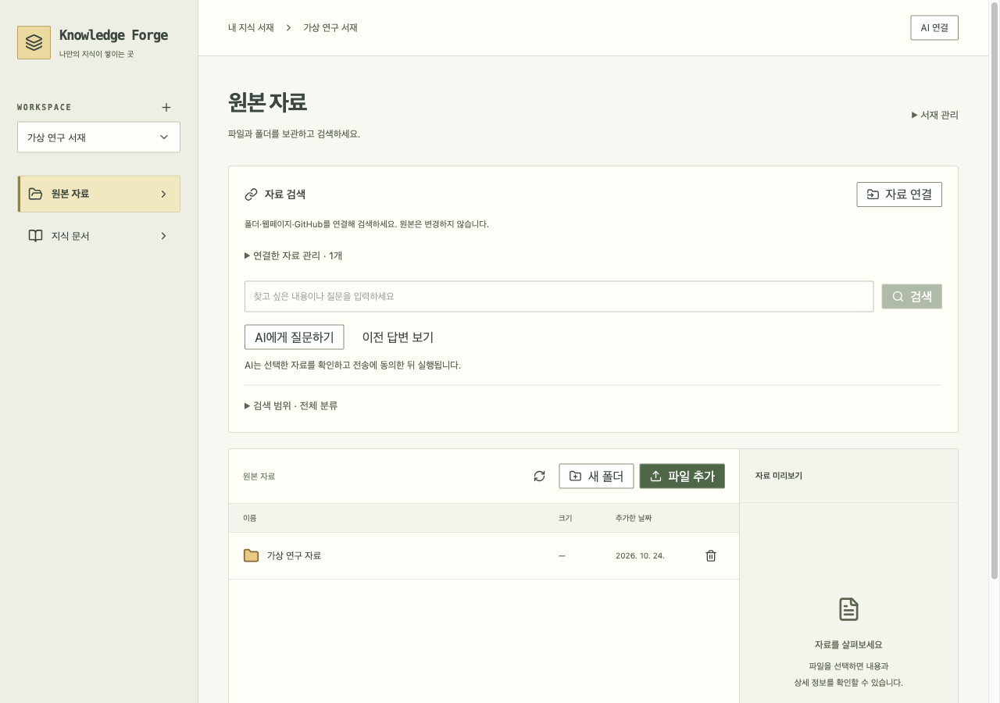
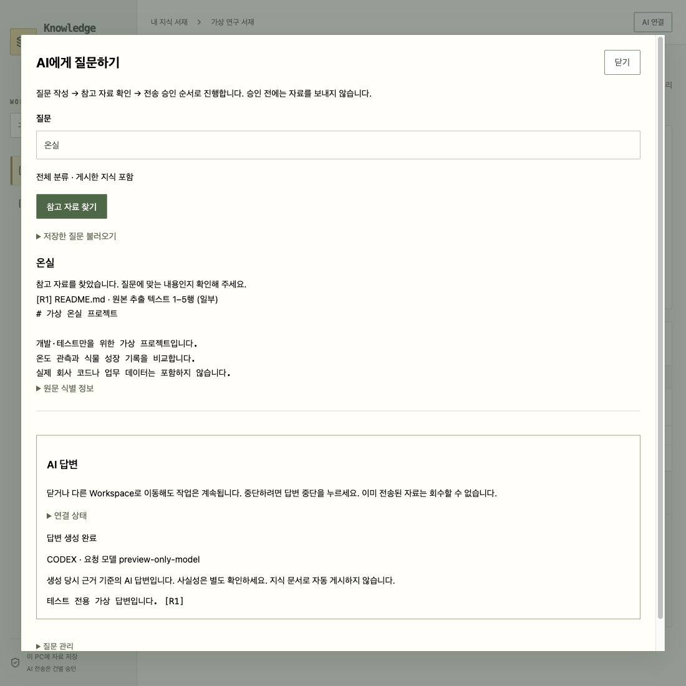
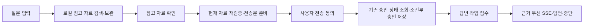

# 필요한 기능만 먼저 보기

## 평소에는 이것만 쓰세요

1. **파일 추가 / 자료 연결**로 자료를 넣습니다.
2. **AI에게 질문하기**에서 질문을 쓰고 참고 자료를 찾습니다.
3. 자료를 확인하고 **이 자료로 답변 준비 → 동의하고 답변 받기**를 누릅니다.
4. 받은 답변은 **이전 답변 보기**에서 다시 읽습니다.

동의 전에는 외부 AI에 자료를 보내지 않습니다. 답변 생성 중에는 **답변 중단**을 누를 수 있습니다. 창을 닫는 것은 중단이 아닙니다.

## 덜 보이게 만든 것

- 연결된 자료의 동기화·수정·삭제·자동 갱신은 **연결한 자료 관리**에 모았습니다. 오류·수집 중·가져오기 필요 상태는 접힌 제목에도 표시합니다. 새 자료를 등록하면 관리 영역을 자동으로 열어 첫 동기화를 놓치지 않게 합니다.
- 코드 심볼·재분석은 파일의 **분석 상세**에서만 봅니다.
- 지식 문서는 그대로 보관합니다. 폴더 정리·AI 다듬기·검토와 게시는 필요할 때 펼칩니다. 게시 상태와 오래된 근거 경고는 숨기지 않습니다.
- 대화 보관함과 이전 문맥 선택은 **대화 정리·이어서 질문하기**로 옮겼습니다.
- 중복 서재 요약과 기술 안내를 기본 화면에서 제거했습니다.

자료·문서·이력을 삭제한 것이 아닙니다. 자주 쓰는 작업과 관리 도구를 구분했습니다.

## 실제 화면

가상 자료와 테스트용 답변으로 확인한 화면입니다.

## 내부 작동과 코드 대조

`EvidenceBundlePanel → QuickAnswerPanel → AnswerJobsPanel`이 기본 질문 경로입니다. 별도 검증·승인 상태·작업 조회 버튼은 제거했습니다. 이전 `EvidenceAnswerPreparation` 컴포넌트는 삭제했습니다. 이전 문맥을 선택하는 고급 경로의 `AnswerApprovalPanel`은 유지합니다.

백엔드는 기존 `EvidenceAnswerPreview`, `AnswerApprovalService`, `AnswerJobService`를 그대로 사용합니다. 미리보기의 묶음·해시·제공자·유효성을 검사하고, 사용자가 동의한 뒤에만 기존 승인 ID로 충돌을 검사하며 새 승인을 저장합니다. 승인 결과의 묶음·해시·제공자·모델이 일치해야 작업을 접수합니다. DB v21·API 계약은 변경하지 않습니다.

접수 응답을 놓치면 같은 요청 ID·승인 ID로 다시 확인합니다. 자동 재전송하거나 새 요청 ID로 생성하지 않습니다. 화면을 닫으면 남은 클라이언트 요청을 중단하지만 서버가 이미 접수한 작업은 계속될 수 있습니다. 다시 열린 화면이 과거 동의를 자동으로 사용하지 않습니다.

`QuickAnswerPanel.test.tsx`는 동의 전 비전송·조건 변경·잘못된 승인·응답 유실 시 같은 ID·닫기 중 후속 요청 차단을 검사합니다. `AnswerJobsPanel.test.tsx`는 간편 화면에서도 SSE와 중단을 검사합니다. 자료·폴더·게시 테스트는 접힌 관리 도구의 기존 동작과 보존 경계를 확인합니다.
