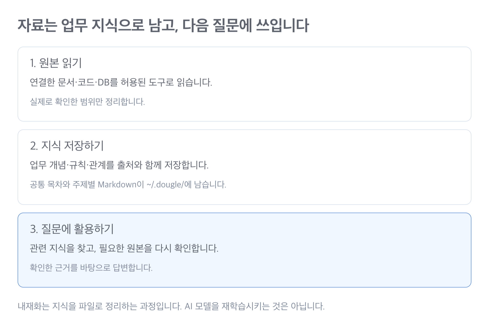

# 지식은 어떻게 저장되나요?

**세션을 닫아도 저장된 지식은 `~/.dougle/`에 남습니다.**

더글에서 말하는 **내재화는 업무 지식을 외부 파일에 정리하고, 질문할 때 다시 읽어 사용하는 것**입니다. AI 모델의 가중치를 바꾸거나 영구적으로 학습시키는 방식은 아닙니다.

## 그래프 방식인가요?

**현재는 업무 개념별 Markdown 기억 + 근거가 붙은 관계 기록 방식입니다.** 개념 사이의 연결은 기록하지만 그래프 DB나 자동 그래프 탐색 엔진은 없습니다.

| 구분 | 현재 더글 |
|---|---|
| 모델 재학습·파인튜닝 | 하지 않습니다. 같은 모델이 저장된 지식을 읽어 답합니다. |
| 지식 저장 | 로컬 Markdown에 업무 개념·규칙·관계·출처를 저장합니다. |
| 그래프 | 문서 → API → 함수 → 테이블 같은 관계를 기록합니다. 노드·엣지를 별도 DB로 관리하거나 그래프 쿼리를 실행하지는 않습니다. |
| 벡터 검색·GraphRAG | 더글 자체 임베딩·벡터 DB·GraphRAG 파이프라인은 없습니다. |
| 검색·답변 실행 | 현재 AI가 가진 파일 읽기·검색·서비스 조회 도구로 수행합니다. |

연결된 메모라는 점에서는 그래프처럼 볼 수 있습니다. 다만 **“자동으로 구축·검증되는 지식 그래프”라고 부르면 현재 구현보다 과장된 설명**입니다. AI가 스킬의 정리 절차를 따르는 구조이며, 관계와 근거의 정확성을 DB 제약으로 강제하지 않습니다.

## 내재화에서 답변까지

매번 모든 자료를 프롬프트에 넣지 않습니다. 목차와 관련 주제부터 읽어 확인할 원본을 좁힙니다. 읽고 정리하는 주체도, 답변하는 주체도 현재 사용 중인 AI입니다.

## 저장하는 파일

| 파일 | 담는 내용 |
|---|---|
| `index.md` | 실행 위치와 무관한 공통 목차. 주제·동의어·식별자와 기존 지식 위치 |
| `sources/*.md` | 자료의 식별 정보, 읽은 범위, 확인 시점·버전, 범위별 마지막 확인 성공·시도와 확인 주기 |
| `knowledge/*.md` | 업무 개념, 규칙, 코드·API·테이블의 관계와 근거 |
| `contexts/<context-id>.md` — 필요한 경우 | 특정 업무의 짧은 맥락. 다른 대화에 자동 적용하지 않습니다. |
| 공유 기록 | 게시·가져오기 대상, 비교 기준, 완료·중단 기록 |

같은 OS 사용자로 실행한 Claude와 Codex는 어느 디렉토리에서든 같은 `~/.dougle/index.md`를 시작점으로 지식을 찾습니다. 작업 공간 선택은 필요하지 않습니다. 다른 PC에는 [publish·fetch](sharing.md)로 선택한 지식을 옮길 수 있습니다.

## 실행 디렉토리와 지식 범위

자료의 원래 폴더 경로는 출처 정보입니다. AI를 다른 폴더에서 실행했다고 검색할 지식을 바꾸지 않습니다. 단, “현재 폴더 연결”·`./service`처럼 위치를 직접 지정한 요청은 실제 실행 디렉토리 기준으로 해석합니다.

프로젝트·서비스·계정·사이트 정보는 각 자료와 주장에 남습니다. 공통 저장소라고 해서 이름이 같은 테이블이나 업무 개념을 합치지는 않습니다. 질문에서 특정 프로젝트를 지정하면 그 범위로 좁히고, 여러 시스템이 해당하면 확인합니다.

## 기존 지식은 어떻게 되나요?

`~/.dougle/workspaces/<이름>/workspace.md`가 있으면 그 목차를 공통 `index.md`에 연결합니다. 기존 파일과 상대 출처 링크는 그대로 두고, 관련 주제만 읽습니다. 이전 폴더와 현재 실행 경로가 같을 필요는 없습니다.

기존 두 폴더에 각각 `S001`이 있어도 별개의 기록으로 구분합니다. 실제 출처가 같은지 확인하기 전에는 합치지 않습니다. 재실행·중단 후에도 이미 등록한 연결을 반복 생성하지 않습니다.

기존 자료별 설정·확인 시각·공유 기록은 보존합니다. 이전 작업 공간의 명시적 갱신 주기는 그 자료 묶음에만 유지하며, 이를 새 전역 기본값으로 강제하지 않습니다. 사용자가 모든 자료의 주기를 바꾸라고 요청하면 그 범위를 적용합니다.

호스트가 `~/.dougle/` 접근을 막으면 필요한 접근 권한을 안내합니다. 다른 디렉토리에 임시 지식 저장소를 만들거나 권한을 우회하지 않습니다. 전체 대화·원본 자료·다른 사용자의 지식은 자동 이전하지 않습니다.

## 자료를 연결하면

1. 공통 목차에서 기존 기록을 확인하고, 요청한 원본 자료의 실제 위치와 업무 범위를 식별합니다.
2. 같은 자료가 있으면 재사용하고, 필요한 원문을 읽습니다.
3. 문서별 요약만 쌓지 않고 업무 개념별로 정리합니다.
4. 각 설명에 근거와 확인 시점을 붙입니다.
5. 원본 변경이나 사용자 정정이 있으면 관련 지식을 갱신합니다.

같은 저장소에 있다는 이유만으로 API와 테이블이 연결됐다고 단정하지 않습니다. 직접 확인한 사실, 사용자의 설명, AI의 추론도 구분합니다.

## 지식 한 건에는 무엇이 들어가나요?

예를 들어 “입하 확정”이라는 주제로 아래 내용을 정리합니다. **다음은 구조 설명용 가상 예시입니다. 실제 회사의 테이블이나 동작이 아닙니다.**

| 항목 | 저장할 내용의 예 |
|---|---|
| 업무 개념 | 입하 확정, 동의어, 관련 코드 식별자 |
| 규칙 | 확인된 선행 조건, 상태 변경, 예외 |
| 시스템 관계 | 특정 API가 confirmReceipt()를 호출하고, 그 함수가 receipt에 기록한다는 관계 |
| 주장과 근거 | C01이라는 주장 ID, 원본 S001의 함수·파일 위치, 확인 시점·버전 |
| 확인 상태 | 직접 확인한 사실인지, 사용자 설명인지, 추론인지와 재확인 필요 여부 |

관계의 **각 연결마다** 근거가 필요합니다. API와 테이블이 같은 프로젝트에 있다는 사실만으로 둘이 연결됐다고 저장하지 않습니다. 코드에서 확인한 동작과 문서의 설명이 다르면 충돌로 남깁니다.

하나의 주제에 여러 자료의 근거를 모읍니다. 문서 하나마다 요약 파일을 쌓기만 하는 방식과의 차이입니다. 원본 전체나 전체 대화를 저장하는 것은 아닙니다.

## 질문하면

1. 공통 저장소의 주제·동의어 목차에서 관련 주제와 원본 위치를 좁힙니다. 기존 목차가 없으면 필요한 주제부터 보완합니다.
2. 동의어·한영 표현·코드 식별자를 묶어 관련 범위부터 검색합니다. 독립적인 조회는 호스트가 지원하는 범위에서 묶되 기록 저장은 순서대로 합니다. 근거가 부족하면 범위를 넓힙니다.
3. 관련 자료 범위의 마지막 성공한 확인 시각과 주기(기본 1시간)를 비교합니다. 기한이 지났거나 변경·충돌·확인 이력 부재가 있으면 원본과 관련 지식을 갱신합니다. 현재 상태를 묻는 질문은 항상 새로 확인합니다.
4. 확인된 사실과 해석을 구분해 짧게 답하고, 주장과 원본 출처를 연결해 표시합니다. 최신 상태를 확인하지 못하면 관찰 시점과 한계를 함께 알립니다.
5. 새로 확인한 재사용 가능한 지식이나 사용자 정정이 있으면 해당 기록을 갱신합니다.

최근 확인한 안정적인 업무 지식은 출처가 충분하고 변경 징후가 없다면 재사용합니다. 저장된 기억은 **어디를 확인할지 알려주는 단서**이며, 기억 파일에 적혀 있다는 이유만으로 현재 상태를 단정하지 않습니다. 모델과 도구에 따라 검색·정리 품질이 달라질 수 있으며, 이 구조만으로 모든 관련 근거를 찾는다고 보장하지 않습니다.

자료 전체를 다시 정리하려면 [reload](reload.md)를 요청하세요. 자동 감시·자동 임베딩·별도 검색 서버는 없습니다.

## 자료가 바뀌거나 세션이 끝나면

- **원본 변경:** ask에서 확인 기한이 지난 관련 자료를 읽거나 수동 reload를 실행하면 영향을 받는 주장과 관계를 갱신합니다. 자동 감시는 없습니다.
- **사용자 정정:** 사용자 설명으로 기록하고, 원본과 다르면 확인 전까지 양쪽을 구분해 둡니다.
- **세션 종료:** 저장된 파일은 남습니다. 다음 AI 세션이 공통 저장소에서 관련 기록을 다시 읽습니다. 저장하지 않은 대화까지 복구되지는 않습니다.
- **팀 공유:** publish·fetch로 선택한 정제 지식을 공유하고 병합합니다. 모델이나 원본 서비스의 로그인 권한이 옮겨지는 것은 아닙니다.

## 갱신 시각과 범위

자료 기록에 `refresh_interval_seconds`를 저장할 수 있습니다. `index.md`의 `default_refresh_interval_seconds`보다 자료별 값이 우선하며, 둘 다 없으면 86,400초입니다. 0은 매 질문 확인을 뜻합니다.

실제로 확인한 파일·문서·스키마 범위마다 `last_attempt_at`과 `last_verified_at`을 구분합니다. 시간대가 포함된 실제 시각으로 경과 시간을 비교하며, 등록 날짜나 파일 수정 시각을 확인 성공 시각으로 대신 쓰지 않습니다. `경과 시간 >= 간격`이면 갱신 대상입니다.

기준 시각이 없거나 잘못됐거나 미래이면 최신이라고 판단하지 않고 확인합니다. 실패·중단은 성공 시각을 바꾸지 않습니다. 변경된 내용을 읽었어도 관련 기억 저장까지 끝나야 해당 범위의 성공 시각을 갱신합니다. 로컬 코드의 커밋 ID만 같아도 미커밋 변경이 있을 수 있어 실제 작업 파일을 확인합니다.

확인 주기와 로컬 성공 기록은 공유 패키지에서 제외합니다. 원격 작성자의 관찰 시점은 근거로 남지만, 가져온 사람이 직접 확인한 시각으로 사용하지 않습니다.

## 기록할 때 지키는 범위

- 원본 코드·문서·DB는 읽기만 합니다. 지정한 지식 저장소에 게시하는 publish는 예외입니다.
- 기억 파일은 평문입니다. 비밀정보·원본 전체·개인정보 행·숨겨진 사고 과정은 저장하지 않습니다.
- 저장 권한이 없으면 우회하지 않고 저장하지 못했다고 알립니다.
- 공통 저장소에 여러 AI가 동시에 쓰는 일은 피합니다. 변경이 충돌하면 최신 파일을 다시 읽습니다.

스킬 자체가 AI의 모든 도구 권한을 차단하지는 않습니다. 원본 서비스에는 읽기 전용 권한을 적용하세요.

공유 지식의 내부 구조

공유 패키지는 `manifest.md`, `sources/*.md`, `topics/*.md`로 구성합니다. 팀 공통 프로젝트·자료·주장 ID와 개인 PC 경로를 분리합니다.

로컬 공유 기록에는 원격 저장소·브랜치·패키지 경로, 성공한 게시·병합 커밋, 비교 기준점, 중단 상태를 보관합니다. fetch는 확정한 원격 커밋과 로컬 지식, 마지막 기준점을 비교합니다.

충돌한 주장은 양쪽 근거를 보존하고 관련 질문에 답할 때 드러냅니다. 가져온 지식만으로 원본 접근이나 최신성을 확인했다고 처리하지 않습니다.

[자료 정리 세부 규칙](../../skills/dougle-connect/references/organization.md) · [공유 세부 규칙](../../skills/dougle-fetch/references/sharing.md)

[검색 속도와 Lucene 비교](search-performance.md) · [답변 출처 표시](answer-sources.md)

## 필요한 지침만 읽기

공통 organization.md는 항상 적용할 핵심 규칙과 참조 조건을 담습니다. store.md·retrieval.md·records.md·freshness.md·operations.md는 해당 작업에만 읽습니다. [문맥 최적화](context-optimization.md)는 근거·예외·최신성 검사를 유지합니다.

## 토픽 안내와 부분 갱신

새로 저장하거나 실제로 갱신하는 토픽은 설명 위치·조건·예외로 가는 안내를 보완합니다. 기존 기록을 일괄 변환하지 않습니다. [저장·탐색 세부 방식](topic-navigation.md)
