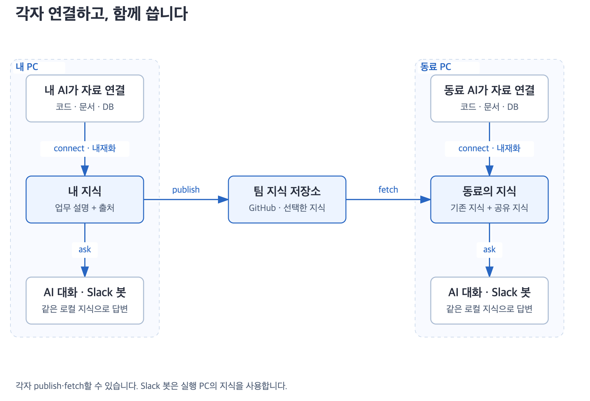

# 더글은 어떻게 동작하나요?

더글은 로컬에서 쓰는 AI가 원본 자료를 읽고 `~/.dougle/`에 업무 지식을 정리해 다시 사용하도록 돕는 스킬 묶음입니다. publish·fetch로 선택한 지식을 공유하며 호스트 AI와 선택형 Slack 봇이 같은 Markdown 지식을 사용합니다. [전체 구조](../design.md)



## 1. 실행부터 답변까지

[스킬을 설치](install.md)한 뒤 자료를 연결하고 질문합니다. Claude 플러그인 예시입니다.

```text
/dougle:dougle-connect /Users/me/work/receiving 코드를 읽고 입하 확정 흐름을 정리해 줘.
/dougle:dougle-ask 입하 확정할 때 어느 테이블에 기록해?
어느 코드를 중점적으로 보면 돼?
```

Codex에서는 `$dougle-connect`, `$dougle-ask`를 사용합니다. 명시적 호출이 가장 확실하며 자동 선택은 호스트 설정과 요청에 따라 달라집니다. 후속 질문은 현재 대화의 주제를 이어받습니다.

## 2. 자료 연결은 누가 하나요?

호스트 AI가 이미 사용할 수 있는 도구로 읽습니다. 사용자는 위치와 읽을 범위를 알려주시면 됩니다.

| 자료 | 필요한 호스트 도구·권한 |
|---|---|
| 코드·로컬 문서 | 파일 읽기·검색, 해당 경로 접근 |
| Confluence·Notion | 해당 서비스 조회 도구와 계정 권한 |
| DB | 승인된 읽기 전용 DB 도구와 조회 범위 |
| 웹 문서 | 웹·문서 조회 도구, 필요한 경우 인증 |

스킬 설치만으로 SSO나 DB 연결이 생기지는 않습니다. 연결할 때 실제 위치·사이트·페이지 ID를 대조해 같은 자료의 기록을 재사용하고 실제로 읽은 범위를 남깁니다. 읽기 실패를 내용 부재로 처리하거나 일부만 읽고 전체를 습득했다고 표시하지 않습니다. [연결 규칙](connections.md)

## 3. ‘내재화’는 무엇을 저장하나요?

업무 개념과 용어, 조건·예외·상태 변화, 확인된 코드·API·테이블 관계를 저장합니다. 주장마다 원본 위치·관찰 시점과 직접 확인·사용자 설명·추론 여부를 붙이며 모르는 부분과 충돌도 남깁니다.

모델을 재학습하거나 원본·대화 전체를 복제하지 않습니다. 관계는 Markdown에 기록하며 별도 그래프 DB나 임베딩 엔진은 없습니다. [지식 구조](architecture.md)

## 4. 기억은 어디에 남나요?

```text
~/.dougle/
  index.md                공통 목차와 기본 확인 주기
  sources/                자료 식별 정보·범위·조회 이력
  knowledge/              업무별 주장·출처·예외·충돌
  sharing/                공유 대상과 병합 기준점
  contexts/               필요한 경우 저장한 업무 인계 맥락
  workspaces/             기존 기록을 보존하고 목차로 연결
```

같은 OS 계정에서 이 경로에 접근하는 Claude·Codex·로컬 봇은 같은 지식을 사용합니다. 실행 폴더는 지식 범위를 바꾸지 않으며 프로젝트는 출처 속성으로 구분합니다. 다른 계정·PC·격리 환경은 자동으로 연결되지 않습니다.

세션이 끝나도 저장한 파일은 남습니다. 새 세션은 목차와 관련 지식을 다시 읽지만 이전 대화 전체를 복원하지는 않습니다. 주제가 불분명하면 대상을 확인하고 원본 접근 권한이 사라졌다면 재확인 한계를 알립니다.

## 5. 질문하면 무엇을 얼마나 읽나요?

1. 질문과 현재 업무 주제를 파악합니다.
2. 목차의 동의어·코드 식별자로 토픽을 찾고 안내와 실제 항목 목록을 대조합니다.
3. 관련 주장·조건·예외·충돌·출처와 확인 범위를 읽습니다.
4. 근거가 부족하거나 재확인이 필요하면 원본 구절부터 읽고 연관 함수·조건으로 범위를 넓힙니다.
5. 확인한 사실과 추론을 구분해 답하고 원본 출처를 표시합니다.

처음 찾은 후보는 시작점입니다. 전체 목록 요청을 몇 개 결과로 제한하거나 이름이 함께 나온다는 이유로 호출 관계를 단정하지 않습니다. 도구 한계나 접근 실패로 더 확인할 수 없으면 미확인 범위를 밝힙니다. [항목별 읽기와 기존 형식 호환](topic-navigation.md)

## 6. 자료가 바뀌면 어떻게 하나요?

기본적으로 관련 질문마다 원본의 변경을 확인합니다. 명시한 자료별·기존 묶음·공통 확인 주기는 유지합니다. 변경이 없고 근거가 충분하면 재사용하고 변경이 있으면 필요한 원문과 관련 지식만 갱신합니다. 현재 상태·실제 구현 질문은 필요한 직접 조회를 수행합니다.

확인과 기억 저장이 모두 끝난 범위만 갱신 성공으로 기록합니다. 저장이 막혀도 이번에 읽은 근거로 답할 수 있지만 기억 갱신을 완료했다고 표시하지는 않습니다. 별도 갱신 명령이나 원본의 백그라운드 감시는 없습니다. [확인 범위와 실패 처리](freshness.md)

## 7. 토큰을 줄이는 장치는 어디에 있나요?

공통 규칙은 읽고 저장소·검색·갱신 등 상세 지침은 해당 작업에만 읽습니다. 현재 문맥에 남아 있는 유효한 근거는 재사용하되 문맥을 잃거나 원본이 바뀌면 다시 확인합니다. 경로만 알고 근거를 잃었다면 원문을 읽습니다.

출처·예외·최신성 확인은 생략하지 않습니다. 호스트의 KV 캐시나 과금은 더글이 제어하지 않습니다. [지침별 읽기 조건과 평가](context-optimization.md) · [답변 스킬 활성화](skill-activation.md)

## 8. 팀과는 어떻게 공유하나요?

```text
/dougle:dougle-publish 팀 지식 저장소에 입하 업무 지식만 공유해 줘.
/dougle:dougle-fetch 팀 지식 저장소의 변경을 가져와 기존 지식과 합쳐 줘.
```

publish는 지정한 범위와 저장소에 정제 지식을 게시하고 fetch는 가져온 내용을 기존 지식·정정·출처와 병합합니다. 대상과 공개 범위를 확인하며 공통 저장소 전체를 임의로 공유하지 않습니다. 원격 삭제로 로컬 지식 전체를 지우지 않고 충돌을 보존합니다. 가져온 관찰 시점은 로컬 재확인 성공 시각이 아닙니다. [공유와 병합](sharing.md)

## 9. 누가 무엇을 보장하나요?

| 주체 | 역할 |
|---|---|
| 더글 스킬 | 정리·검색·갱신·답변·공유 절차 안내 |
| 호스트 AI | 도구 선택, 자료 해석, 답변·기억 작성 |
| 호스트 도구·계정 | 실제 접근과 권한 제한 |
| 로컬 Markdown | 세션을 넘어 지식·출처·확인 기록 보존 |

원본은 읽기 전용이며 로컬 기억과 명시적으로 요청한 지식 게시만 쓰기 대상입니다. 스킬 자체는 강제 샌드박스가 아니므로 실제 권한도 설정해야 합니다. 근거 확인과 회귀 검사로 오류를 줄이지만 모델의 검색·해석이 항상 맞는다고 보장하지 않습니다. [검증 범위](verification.md)

## Slack 문의 감시

[dougle-schedule](schedule.md)은 기존 Slack MCP와 실제 호스트 타이머로 문의를 읽고 초안을 준비합니다. 로컬 사용자가 해당 초안을 승인해야 답글을 쓰며 타이머는 게시하지 않습니다. 운영 기록은 공유 지식에서 제외합니다.

## Optional Slack bot

선택형 [Slack 봇](../../dougle-bot/README.md)은 로컬 Python 실행기와 Claude CLI로 문의를 처리합니다. 등록 채널의 멘션을 받아 같은 `~/.dougle/` 지식과 스킬로 조사하고 검증을 통과한 답변을 원래 스레드에 자동 게시합니다.

내부 DM은 운영 조회·개발자 도움·오류 처리에 사용합니다. 자동 모드에서 도움 요청 DM 전송에 성공하면 원래 문의에 짧은 대기 안내를 한 번 시도합니다. 담당자 결과를 받아 검증한 뒤 답변을 이어갑니다. `require_approval=true`로 지정한 검토 모드와 기존 승인 대기 답변은 별도로 유지합니다. [봇 처리 구조](../design-reference.md#3-질문이-오면-어떻게-흐르나요)
