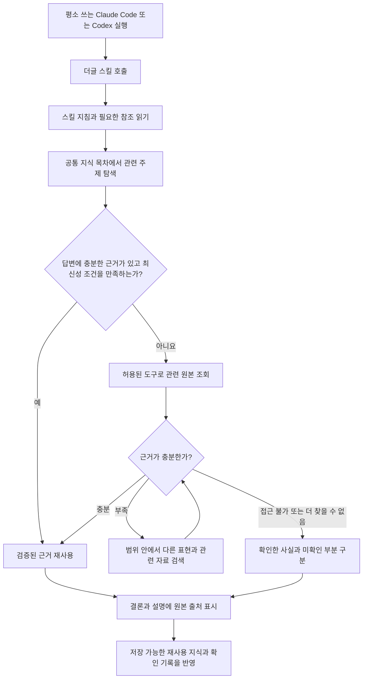

# 더글은 어떻게 동작하나요?

**더글은 평소 쓰는 AI에게 업무 지식을 찾고 기억하는 방법을 알려주는 스킬 묶음입니다.** Claude Code나 Codex가 스킬 지침을 읽고, 자신에게 연결된 도구로 자료를 조회합니다. 더글 자체가 별도 AI 모델을 실행하거나 회사 서비스의 로그인·검색 도구를 제공하지는 않습니다.

## 1. 실행부터 답변까지



그림의 마지막 단계는 개념적인 흐름입니다. 갱신 완료 시각은 실제 확인과 관련 기억 저장이 모두 끝난 범위에만 기록합니다. 저장이 허용되지 않아도 이번에 읽은 원본으로 답할 수 있지만, 기억 갱신까지 완료됐다고 말하지 않습니다. 검색은 무한 반복하지 않습니다. 도구 한계·접근 실패·새로운 근거가 없는 상태에서는 확인하지 못한 범위를 밝힙니다.

### 처음 사용할 때

1. [설치 안내](install.md)에 따라 다섯 스킬과 참조 파일을 설치합니다.
2. 평소처럼 AI를 실행합니다. 회사에서 `claude-work`를 쓴다면 그대로 실행합니다.
3. 자료 연결 요청을 합니다.
4. 업무를 질문합니다. 다음 질문은 같은 대화의 주제를 이어받습니다.

Claude 플러그인 예시:

```text
/dougle:dougle-connect /Users/me/work/receiving 코드를 읽고 입하 확정 흐름을 정리해 줘.
/dougle:dougle-ask 입하 확정할 때 어느 테이블에 기록해?
어느 코드를 중점적으로 보면 돼?
```

Codex에서는 같은 요청에 `$dougle-connect`, `$dougle-ask`를 사용합니다. 명시적 호출이 가장 확실하며, 호스트의 자동 스킬 선택은 호스트 설정과 요청에 따라 달라집니다.

## 2. 자료 연결은 누가 하나요?

**호스트 AI가 이미 사용할 수 있는 조회 도구로 읽습니다.** 사용자는 자연어로 자료 위치와 원하는 범위를 알려줍니다.

| 자료 | 실제 조회 방법 | 접근이 안 될 때 |
|---|---|---|
| 코드·로컬 문서 | 호스트의 파일 읽기·검색 도구 | 경로와 파일 접근 권한 확인 |
| Confluence·Notion | 호스트에 연결된 해당 서비스 조회 도구 | 연결된 계정·조회 권한·도구 유무 안내 |
| DB | 호스트의 승인된 읽기 전용 DB 도구 | 필요한 연결과 읽기 범위 안내 |
| 다른 웹 문서 | 사용 가능한 웹·문서 조회 도구 | 공개 접근 가능 여부 또는 필요한 인증 안내 |

더글 설치만으로 SSO가 완료되거나 DB 연결이 생기지는 않습니다. 없는 도구를 만들었다고 가정하거나, 권한 제한을 우회해서 읽지 않습니다. 읽기 실패는 자료에 내용이 없다는 뜻이 아닙니다.

연결 시에는 **자료의 실제 동일성 → 기존 등록 여부 → 실제 읽은 범위 → 지식 정리**를 확인합니다. 같은 파일 경로나 동일 사이트·페이지 ID라면 기존 기록을 재사용하거나 갱신합니다. 이름이 같아도 다른 서비스·테넌트라면 별도 자료입니다. 큰 폴더의 일부만 읽었다면 전체를 습득했다고 표시하지 않습니다. [자세한 연결 규칙](connections.md)

## 3. ‘내재화’는 무엇을 저장하나요?

**모델을 재학습하는 것이 아니라, 다음 세션에서도 읽을 수 있는 업무 기억을 파일에 저장합니다.**

예를 들어 입하 코드를 읽으면 다음을 정리합니다.

- 입하 확정이라는 개념과 관련 용어.
- 확인한 조건·예외·상태 변화.
- 문서 → API → 함수 → 테이블의 관계 중 실제 근거가 있는 연결.
- 주장별 원본 위치, 관찰 시각, 직접 확인인지 사용자 설명인지 추론인지.
- 아직 모르는 부분과 자료 간 충돌.

원본 전체를 무조건 복제하거나 모든 대화를 저장하지 않습니다. 관계를 기록하지만 그래프 DB나 GraphRAG 엔진을 구동하는 것은 아닙니다. 상세 구조는 [내재화 방식](architecture.md)에 설명합니다.

## 4. 기억은 어디에 남나요?

현재 로그인한 사용자의 홈 디렉토리 아래 **`~/.dougle/`**를 사용합니다. AI를 어느 폴더에서 실행하든 같은 목차부터 찾습니다.

```text
~/.dougle/
  index.md                주제·출처·기존 지식 목차와 기본 갱신 주기
  sources/                자료의 정체성·범위·조회 이력
  knowledge/              개념별 주장·출처·예외·충돌
  sharing/                선택한 공유 저장소와 병합 기준점
  contexts/               필요한 경우 저장한 업무 인계 맥락
  workspaces/             이전 버전 기록: 보존하고 목차로 연결
```

Claude와 Codex가 같은 사용자 계정에서 이 경로에 접근할 수 있으면 같은 기억을 사용합니다. 프로젝트 이름은 출처의 속성으로 구분합니다. 다른 OS 계정·다른 PC·격리 환경은 홈 디렉토리가 다르므로 자동으로 같은 파일을 공유하지 않습니다.

세션을 닫아도 **이미 저장된 파일은 남습니다.** 새 세션은 스킬을 다시 호출해 목차와 관련 기억을 읽습니다. 이전 대화 전체가 자동 복원되는 것은 아닙니다. “그거”처럼 주제가 불분명하면 대상 확인이 필요할 수 있습니다. 원본 접근 권한이 사라지면 현재 내용 재확인은 불가능할 수 있습니다.

## 5. 질문하면 무엇을 얼마나 읽나요?

1. 질문과 현재 대화의 업무 주제를 파악합니다.
2. 공통 목차의 주제·한영 동의어·코드 식별자로 관련 기억을 찾습니다.
3. 관련 주장과 원본 위치, 실제 확인 범위를 읽습니다.
4. 근거가 충분한지와 재확인이 필요한지 판단합니다.
5. 필요하면 원본의 관련 구절부터 읽고, 조건·예외·연관 함수가 필요하면 범위를 넓힙니다.
6. 답을 뒷받침한 원본을 출처로 표시합니다.

처음 몇 개 후보는 검색의 시작점입니다. 정답이 없거나 충돌하면 추가로 찾습니다. “전체 목록” 질문을 임의로 세 개까지만 검색하지 않습니다. 코드에 API와 테이블 이름이 함께 나온다고 호출 관계를 추정해서 사실로 저장하지 않습니다.

## 6. 자료가 바뀌면 어떻게 하나요?

`ask`는 관련 범위의 **마지막 성공 확인 시각**과 현재 시각을 비교합니다. 기본은 24시간이며, 자료별 설정 → 기존 컬렉션 설정 → 공통 설정 → 기본값 순서로 적용합니다.

- 기한이 지났거나 확인 시각이 없으면 원본을 확인합니다.
- 현재 DB 건수나 최신 설정처럼 실시간 상태를 묻는 질문은 매번 확인합니다.
- 변경·충돌·새로 가져온 지식이 있으면 기한이 남아 있어도 재확인합니다.
- 충분한 근거가 있고 유효한 최근 확인 기록이 있는 안정적인 지식은 재사용합니다.
- 실패한 조회는 마지막 성공 시각을 늦추지 않습니다. 일부만 성공하면 그 범위만 기록합니다.

명시적으로 갱신하려면:

```text
/dougle:dougle-reload 입하 서비스
/dougle:dougle-reload 전체
```

예약 작업이나 백그라운드 감시는 없습니다. 질문 또는 reload가 실행될 때 조회합니다. [갱신 상세](reload.md)

## 7. 토큰을 줄이는 장치는 어디에 있나요?

각 스킬은 공통 핵심 지침을 읽고, 해당 작업에 필요한 상세 문서만 읽도록 구성됩니다.

| 지침 | 읽는 시점 |
|---|---|
| `SKILL.md` + `organization.md` | 스킬 실행과 공통 규칙 확인. 현재 문맥에 그대로 있으면 반복 읽기 생략 |
| `store.md` | 목차가 없거나 기존 지식 발견·경로 해석·저장소 접근 문제가 있을 때 |
| `retrieval.md` | 목차 문제, 반복 검색 실패, 완전한 범위 조사, 목차 보완이 필요할 때 |
| `records.md` | 자료 등록·중복 확인·기억 저장·정정·연결 해제 전 |
| `freshness.md` | 기한 경과·최신성 불명·실시간 조회·주기 변경·확인 기록 저장 전 |
| `operations.md` | reload·publish·fetch의 범위 처리 |
| `sharing.md` | publish·fetch에서 공유·병합 처리 |
| `i-have-adhd.md` | ask 답변 형식에 적용. 현재 문맥에 없을 때 읽기 |

이미 읽은 지침과 근거를 재사용하더라도 문맥이 사라졌거나 원본이 달라졌다면 다시 읽습니다. 파일 경로만 기억하고 실제 근거를 잃었다면 원문을 재조회합니다. 출처·예외·최신성 판단을 토큰 절감 때문에 생략하지 않습니다.

이번 변경은 호스트 모델의 KV 캐시나 요금을 직접 제어하지 않습니다. [최적화 적용과 전후 평가](context-optimization.md)

## 8. 팀과는 어떻게 공유하나요?

`publish`는 사용자가 지정한 저장소와 범위의 정제 지식을 게시합니다. `fetch`는 공유 지식을 가져와 기존 지식·정정·출처와 병합합니다. 원격 삭제가 로컬 지식 전체 삭제로 이어지지 않으며, 충돌은 보존합니다.

```text
/dougle:dougle-publish 팀 지식 저장소에 입하 업무 지식만 공유해 줘.
/dougle:dougle-fetch 팀 지식 저장소의 변경을 가져와 기존 지식과 합쳐 줘.
```

저장소를 처음 지정할 때는 대상과 공개 범위를 확인해야 합니다. 공통 저장소에 있다고 모든 자료를 공유해도 된다는 뜻은 아닙니다. 가져온 정보의 원격 확인 시각은 내 PC의 재확인 성공 기록이 되지 않습니다. [공유와 병합](sharing.md)

## 9. 누가 무엇을 보장하나요?

| 주체 | 역할 |
|---|---|
| 더글 스킬 | 자료 정리·검색·갱신·답변·공유 절차를 지시 |
| 호스트 AI | 지침 해석, 도구 선택, 자료 해석, 답변과 기억 작성 |
| 호스트 도구·계정 권한 | 실제 파일·서비스 접근과 권한 제한 |
| 로컬 기억 파일 | 세션을 넘어 보존할 지식·출처·확인 기록 |

원본 코드·문서·DB는 조회만 합니다. 로컬 기억 작성과 명시적으로 요청한 지식 게시가 쓰기 작업입니다. 다만 스킬 지침 자체가 시스템 전체의 강제 샌드박스는 아닙니다. 실제 읽기 전용 권한은 호스트 도구와 계정에서도 설정되어야 합니다.

검색과 해석에는 모델 판단이 들어갑니다. 절대 무오류를 보장하지 않으며, 근거 연결·누락 시 재검색·불확실성 표시와 회귀 평가로 오류를 줄입니다. [실제로 검증한 범위](verification.md)를 별도로 기록합니다.
