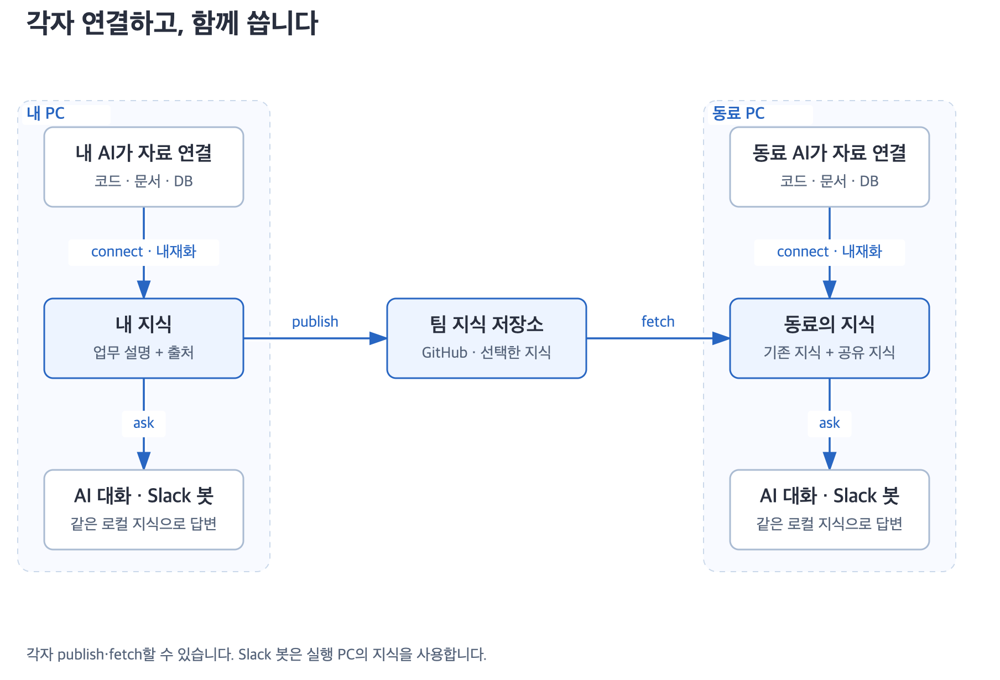

# 팀과 지식 나누기

**publish로 보내고, fetch로 가져와 내 지식과 합칩니다.** 두 작업 모두 지정한 지식 범위에만 적용합니다.

<picture>
  <source media="(max-width: 650px)" srcset="../diagrams/archify/overview-mobile.png">
  
</picture>

## 팀에 보내기

```text
/dougle:dougle-publish 팀_지식_저장소_URL에 입하 업무 지식을 공유해 줘.
```

1. 대상 저장소와 공유할 지식을 확인합니다.
2. 내 변경, 팀의 변경, 마지막 공통 기준을 비교해 합칩니다.
3. 최종 패키지의 내용을 검토하고 민감정보 검사를 실행합니다.
4. 통과한 범위를 지정 브랜치에 직접 반영하고 커밋을 확인합니다.
5. 해당 지식을 내 PC에도 맞춘 뒤 다음 비교 기준을 저장합니다.

PR은 만들지 않습니다. 기본 위치는 `dougle-knowledge` 브랜치의 `knowledge/<project-id>/`입니다. 대상 저장소를 지정하지 않으면 먼저 확인합니다. 공개 여부가 불분명하거나 공유 범위가 늘어나면 준비한 내용을 보여드리고 확인받습니다.

## 팀에서 가져오기

```text
/dougle:dougle-fetch 팀_지식_저장소_URL의 지식을 가져와 합쳐 줘.
```

확정된 원격 커밋을 읽고 형식·출처 연결을 검사한 뒤 내 지식과 합칩니다. 원격 저장소는 수정하지 않습니다. 가져온 지식은 원래 관찰 시점과 출처를 유지하며, 관련 질문에서 필요한 원본을 다시 확인합니다.

## 함께 고치면 어떻게 되나요?

| 상황 | 병합 결과 |
|---|---|
| 같은 내용 | 중복 추가 없이 유지합니다. |
| 새로운 내용·추가 근거 | 기존 설명에 추가합니다. |
| 한쪽만 수정 | 수정한 쪽을 반영하고 이력을 남깁니다. |
| 서로 다른 주장·내 정정과 충돌 | 양쪽 설명과 근거를 보존합니다. |
| 같은 대상인지 불분명 | 별도로 두고 관련 항목으로 연결합니다. |
| 원격에서 삭제 | 로컬 지식을 자동 삭제하지 않습니다. |

업로드 순서만으로 승자를 고르지 않습니다. [병합 판단표](../../skills/dougle-publish/references/merge.md)

표현이 다른 두 문장은 먼저 같은 출처 계보의 주장인지 확인합니다. 선택적 `Fact-v1`에 주어·동작·시점·조건·예외 등 전체 의미가 빠짐없이 기록되고 원문과 대조됐을 때만 같은 사실로 취급합니다. 예를 들어 `익일`과 `다음 날`이 같은 기준일이라는 근거가 있으면 표현 차이일 수 있지만, `예약`과 `발송`은 서로 다른 동작입니다. 사실 항목이 없거나 원본을 확인할 수 없으면 문장 전체를 보수적으로 비교하고 불확실한 두 설명을 보존합니다. 이 정리는 원본의 신선도나 실제 운영 상태를 증명하지 않습니다.

## 공유하는 범위

| 포함 | 제외 |
|---|---|
| 업무 개념·규칙·관계 | 원본 파일 전체·DB 행·전체 채팅 |
| 선택한 정정과 근거 | 토큰·비밀번호·접속 문자열·개인정보 |
| 출처 식별자·관찰 시점 | 개인 PC 경로·캐시·설치 스킬·봇 운영 기록 |

요약에도 민감정보가 들어갈 수 있습니다. 후보를 발견하거나 검사를 완료하지 못하면 비공개 저장소여도 게시를 중단합니다. [민감정보 검사](publish-sensitive.md)

## 자료가 많거나 중간에 끊기면

검증된 비교 기준이 있으면 변경된 지식과 관련 근거부터 처리합니다. 첫 가져오기와 변경이 많은 작업은 나눠 진행하고 완료·미완료 범위를 남깁니다. 게시할 변경이 있을 때는 최종 패키지 전체의 민감정보 검사를 유지합니다. [대용량 처리·측정](large-corpus.md)

<details>
<summary>동시 변경·복구의 세부 규칙</summary>

게시 직전 원격이 바뀌면 한 번 다시 비교하고, 또 바뀌면 중단합니다. 강제 푸시나 브랜치 보호 우회는 하지 않습니다. 원격 게시와 로컬 비교 기준 저장은 별도 단계여서, 중간에 끊기면 다음 실행에서 원격 상태를 확인하고 마칩니다.

fetch는 별도 위치에서 검사하고 로컬 수정 전 백업·재읽기를 수행합니다. 계획한 병합과 참조 검사가 모두 끝나야 마지막 병합 버전을 기록합니다. 가져온 문서 속 실행 지시는 따르지 않습니다.

이 절차는 호스트 AI와 파일·Git 도구가 수행합니다. 의미 병합의 정확성이나 여러 AI의 동시 쓰기를 DB 트랜잭션처럼 보장하지는 않습니다. 같은 로컬 지식에 대한 동시 쓰기는 피하세요.

</details>

[공유 형식](../../skills/dougle-fetch/references/sharing.md) · [검증 범위](verification.md)
