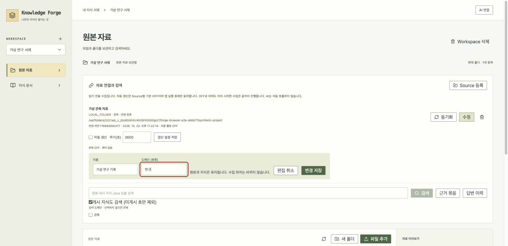

# 등록한 자료의 이름·분류 바꾸기

0.1.6에서 추가합니다. 원본 자료의 등록 목록에서 **수정 → 이름·도메인 입력 → 변경 저장**을 누르세요. 도메인은 사용자가 정하는 분류입니다.



- 원본 파일, 수집 위치, 마지막 반영 버전, 수동 지식·게시본은 유지합니다.
- 이름을 바꾸면 원본 탐색기의 해당 폴더 이름도 바뀝니다.
- 분류를 바꾸면 원본과 관련 게시 지식의 검색 분류도 갱신합니다. 재수집·재분석·AI 호출은 하지 않습니다.
- 수집 중에는 수정할 수 없습니다. 다른 화면에서 설정을 바꾸면 저장을 거절합니다. 입력은 유지되므로 필요한 내용을 복사한 뒤 편집을 닫고 다시 여세요.
- 이미 저장한 근거 묶음은 과거 기록 그대로입니다. 이전 분류로 선택한 묶음은 전송 전 재검증에서 막힐 수 있으므로 다시 검색·확인·승인합니다.
- 수집 위치·자료 종류 변경은 아직 지원하지 않습니다. 새 위치는 새 Source로 등록해야 합니다.

## 모델과 실제 코드

`SourceMetadataEditor → PATCH /sources/{id} → SourceService → SourceStore → JdbcSourceStore`

DB v21을 유지합니다. 기존 `pollingRevision`을 **자료 설정의 공통 충돌 버전**으로 사용합니다. 이름·분류 수정과 폴링 저장 모두 이 값을 증가시키므로 오래된 설정을 덮어쓰지 않습니다. 원격 반영 버전인 `revision`과는 별개입니다.

하나의 트랜잭션에서 Source와 루트 폴더 이름을 수정하고 검색 갱신 큐를 기록합니다. SQL 조건으로 Workspace·설정 버전·수집 중 여부를 함께 확인합니다. 폴더 수정에 실패하면 Source 수정도 롤백됩니다. 기존 게시 지식 분류 트리거와 원본 검색 큐를 사용하며 문서 내용을 바꾸지 않습니다.

## API

`PATCH /api/workspaces/{workspaceId}/sources/{id}`

```json
{"name":"가상 연구 기록","domain":"연구","expectedRevision":0}
```

성공 시 200과 갱신된 Source를 반환합니다. 입력 오류 400, 변경 요청 보호 실패 403, 다른 Workspace/없는 자료 404, 중복 이름·오래된 설정·수집 중 수정 409입니다. `location`과 `kind`는 수정 대상이 아닙니다.

## 검사

- `SourceIntegrationTest`: 원본 ID·반영 버전·수동 지식·게시본 보존, 두 종류 검색 분류 갱신, 기존 근거 묶음 보존/재검증, 충돌·격리·입력·요청 보호, 트랜잭션 실패 롤백.
- `SourceMetadataEditor.test.tsx`: 저장 동의·실패 시 입력 유지·설정 충돌·취소·수집 중 차단.
- `SourcePanel.test.tsx`: 실제 PATCH 경로·화면 갱신·불필요한 수집/AI 호출 없음. 자료 목록을 다시 읽으면 사라진 분류를 검색 조건에서도 제거합니다.

실제 배포·설치 확인 결과는 [0.1.6 보고서](release-0.1.6-report.md)를 따릅니다. 화면 사진은 가상 자료만 사용합니다.
