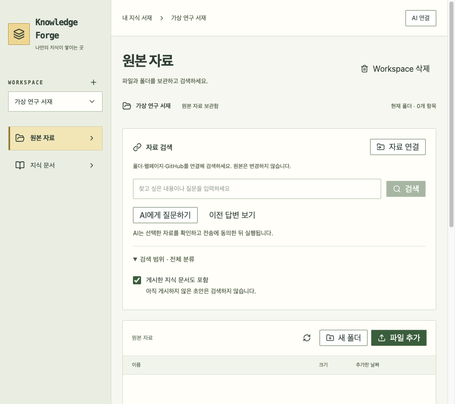
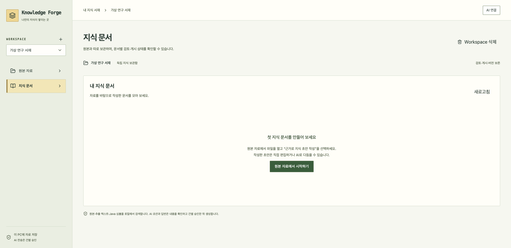
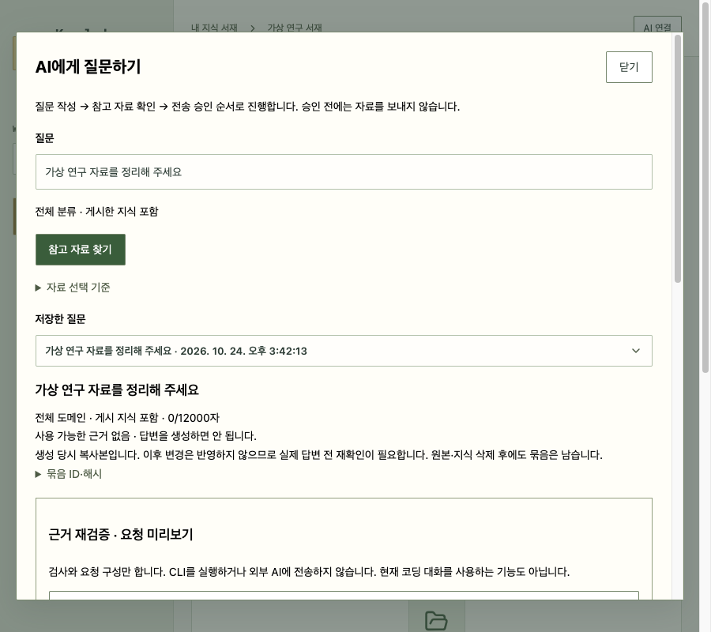

# 더 쉬워진 자료 검색과 지식 문서

## 무엇이 달라졌나요?

- **자료 검색:** 검색창에는 찾을 내용이나 질문을 입력합니다. 분류와 게시 문서 포함 여부는 `검색 범위`를 펼쳐 바꿉니다.
- **AI에게 질문하기:** 예전 `근거 묶음`입니다. 질문을 입력하고 `참고 자료 찾기`로 자료를 확인한 뒤, 기존 전송 승인 절차를 거쳐 답변을 생성합니다. 창을 여는 것만으로 전송하지 않습니다.
- **이전 답변 보기:** 예전 `답변 이력`입니다. 이미 받은 답변을 다시 읽는 기능이므로 삭제하지 않았습니다.
- **지식 문서:** 문서가 없으면 원본 자료로 이동하는 시작 버튼을 보여 줍니다. 빈 AI 작업 패널·불필요한 폴더 새로고침은 표시하지 않습니다.
- **자동 갱신 설정:** 자료별 설정을 펼쳐 변경합니다. 기본 OFF와 명시적 저장은 유지합니다.
- **글자 배치:** 체크박스와 글자 사이 간격·클릭 영역·줄바꿈, 창 안의 제목·입력·버튼 간격을 통일했습니다.

## 보존한 기능

저장된 질문·답변·문서는 삭제하지 않습니다. AI 진행 중 표시·중단·오류 복구는 유지합니다. 자료 출처, 전송 동의, 사람 검토와 게시도 그대로입니다. 내부 용어와 상세 정보만 필요한 위치로 옮겼습니다.

## 실제 화면

가상 자료로 촬영한 화면입니다.

## 코드 대조

`SourcePanel → EvidenceBundlePanel → EvidenceAnswerPreparation → AnswerApprovalPanel`의 기존 자료 보관·미리보기·승인 경로를 사용합니다. 질문 입력을 준비 창 안에서도 할 수 있게 했으며 자동 AI 실행은 추가하지 않았습니다.

`GenerationJobsPanel`은 작업도 오류도 없을 때만 숨깁니다. 진행·실패 작업과 재시도 버튼은 숨기지 않습니다. `KnowledgeOrganization`은 문서와 폴더가 모두 없을 때만 숨기고, 기존 폴더/문서의 이동과 충돌 검사는 유지합니다. DB v21과 API는 변경하지 않았습니다.
