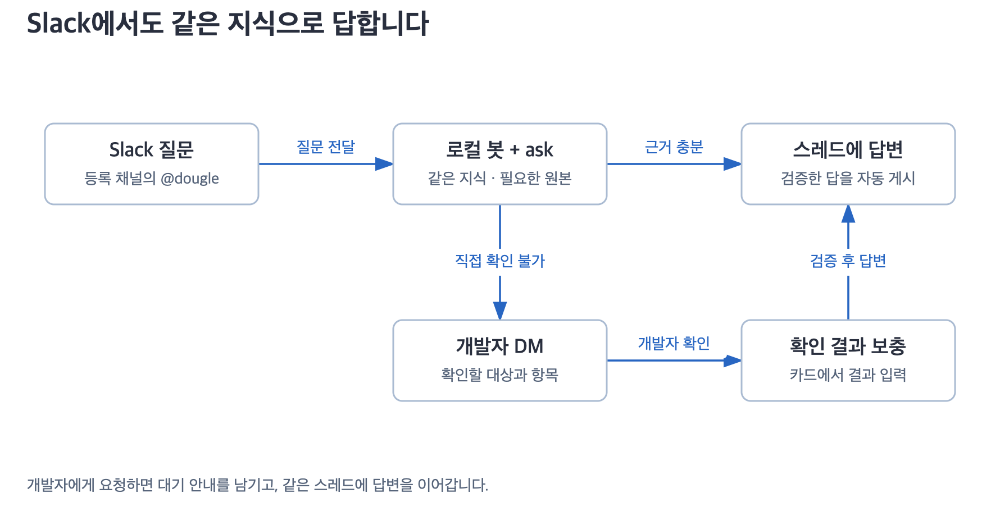

# Dougle Slack 봇

현재 프리뷰 **스킬 0.8.26 / 봇 0.1.23**은 압축 답변 정책을 자동 모드에서도 선택할 수 있게 하고, 정확한 BigQuery 전체 건수와 일부 명시적 정책 문장을 자동 검증합니다. [Codex 합성 평가](../docs/dougle-bot/token-consistency-codex-pilot.md)에서 10개 질문의 입력·출력 토큰 합계가 60.28% 줄었습니다. 실제 Claude·회사 연결 결과는 별도 확인이 필요합니다. 기존 GitHub 원격 파일명 탐색과 시작 점검 비용 상한 제거도 유지합니다.

회사 서버에서 운영할 계획은 [서버 전환 설계 · TO-BE](../docs/server/README.md)를 참고해 주세요. 아래는 현재 로컬 봇의 사용법입니다.

등록된 채널에서 `@dougle 질문`을 보내면 필요한 근거를 확인해 원래 스레드에 답합니다. 기본은 자동 답변이며, 개발자 확인이나 내부 오류 처리가 필요할 때만 담당자에게 DM을 보냅니다.



## 시작하기

플러그인을 업데이트한 뒤 `/dougle:dougle-bot`을 실행하세요.

```text
✦ dougle bot
1. 시작
2. 상태 확인
3. 중지
4. 채널 추가
```

처음에는 설치와 설정을 안내합니다. 시작하면 등록된 채널의 새 멘션을 받습니다. 중지 중 올라온 질문은 나중에 가져오지 않습니다. 채널을 추가할 때는 같은 앱의 토큰을 재사용하며 `/invite @dougle`로 봇을 초대해야 합니다.

## 개발자 확인이 필요한 경우

| 상황 | 동작 |
|---|---|
| 답변 가능 | 원래 스레드에 답합니다. 일반 문의에는 DM을 보내지 않습니다. |
| 질문이 모호함 | 답에 필요한 정보를 질문자에게 묻습니다. |
| 관련 자료를 못 찾음 | 확인한 범위에서 찾지 못한 내용을 알립니다. 기능이 없다고 단정하지 않습니다. |
| 운영 상태·코드를 직접 확인하지 못해 개발자 도움 필요 | 담당자 DM으로 확인 대상과 필요한 결과를 요청합니다. 검증된 SELECT SQL이 있으면 함께 표시합니다. |
| 내부 오류·시간 초과 | 담당자 DM에 점검 사항과 **처리 결과 입력**을 표시합니다. |

자동 답변 모드에서는 개발자 확인 DM 전송이 성공하면 고객 스레드에 다음 안내를 한 번 시도합니다. 명시적 승인 모드는 자동 안내를 보내지 않습니다.

> 추가 확인이 필요해 담당 개발자에게 요청했습니다. 확인되면 이 스레드에 이어서 답변드리겠습니다.

담당자가 DM 카드의 **확인 결과 입력** 또는 **처리 결과 입력**으로 비민감 요약을 제출하면, 필요한 확인을 거쳐 같은 스레드에 답변을 이어갑니다. 결과를 받으면 고객 스레드에 “개발자로부터 확인 내용을 받았습니다. 내용을 확인하고 정리해 답변드리겠습니다.”를 한 번 안내합니다. 결과가 부족하면 남은 확인을 담당자에게 요청합니다. 일반 DM 텍스트나 이미지는 문의에 자동 연결하지 않습니다.

**직접 응대할게요**를 누르면 “담당 개발자가 직접 답변드릴 예정입니다.”라고 고객에게 알리고 해당 문의의 자동 처리를 종료합니다. 사유 입력은 없으며 기존 결과 입력창도 더 이상 사용할 수 없습니다. 새로 `@dougle`을 부르면 별도 문의로 처리합니다.

고객 안내는 자동 답변 모드에서만 보내며, 대기 안내에는 SQL이나 내부 오류를 넣지 않습니다. 안내 전송이 실패하거나 성공 여부가 불분명하면 재시작해도 다시 보내지 않으며, 개발자 결과 처리는 계속 가능합니다. 최종 답변도 전송 여부가 불분명하면 중복을 막기 위해 자동 재전송하지 않습니다.

## 진행 상태와 대화

질문에 `:dougle:`과 `:loadingg:`가 붙고, 확인 결과 대기 중에는 💬, 게시 후에는 `:처리완료:`가 표시됩니다. 오류나 전송 여부 확인이 필요하면 ⚠️로 표시합니다. `dougle`이 없으면 상태만 표시하며, `loadingg` 또는 `처리완료`가 없으면 각각 ⏳ 또는 ✅로 대체합니다.

같은 스레드는 같은 세션을 이어가며 새 최상위 메시지는 별도 대화로 처리합니다. 개발자 결과도 해당 문의에만 사용합니다. 내부 확인 DM은 같은 카드를 갱신하며, 결과 처리 중에는 카드에서 문의별로 중단할 수 있습니다. 일반 문의를 멈추려면 봇을 중지하세요.

## 처음 한 번 준비할 것

M Mac, 로그인한 Claude CLI, Dougle 플러그인, `uv`, 회사에서 승인한 Slack 앱이 필요합니다. 봇은 Python 3.12+와 Slack SDK를 사용합니다. 일반 Dougle 스킬만 쓸 때는 봇 설치가 필요하지 않습니다.

1. Slack의 **Create New App → From a manifest**에 [slack-manifest.yaml](slack-manifest.yaml)을 붙여 넣습니다. 기존 앱이 있으면 재사용합니다.
2. 워크스페이스에 앱을 설치하고 받을 채널에서 `/invite @dougle`을 실행합니다. 비공개 채널도 초대해야 합니다.
3. **OAuth & Permissions**의 봇 토큰과 **App-Level Tokens**의 앱 토큰을 준비합니다. 앱 토큰에는 `connections:write` 권한이 필요합니다.
4. Mac 터미널에서 아래 명령을 실행하고 입력 안내에 따라 토큰을 넣습니다. 토큰을 Claude 대화창이나 명령 뒤에 붙이지 마세요.

```sh
security add-generic-password -U -a dougle-bot -s dougle-bot.slack-bot-token -w
security add-generic-password -U -a dougle-bot -s dougle-bot.slack-app-token -w
```

같은 service/account로 저장했다면 다시 입력하지 않아도 됩니다. 스킬에 내부 확인 담당자 ID, 받을 채널, 평소 Claude 실행 명령을 알려주면 나머지 설정을 진행합니다. 토큰은 런타임만 키체인에서 읽습니다.

공개 서버나 URL은 필요 없습니다. 봇을 실행하는 Mac은 켜져 있고 인터넷에 연결되어 있어야 합니다. 허용 채널과 읽기 자료는 회사에서 공유를 허용한 범위로 설정해 주세요.

## 시작할 때 자동 점검

**시작을 선택하면 Slack 연결 → Claude 실행과 필수 스킬 → 실제 Slack 수신 연결 순서로 확인합니다.** 실패하면 문의를 받기 전에 멈추고 현재 대화에서 필요한 조치를 안내합니다. 로그인·스킬 설치 등을 고친 뒤 다시 시작하면 재점검합니다.

등록된 자료 연결에 문제가 있으면 **복구 후 시작**하거나 **이번에는 미확인 연결을 둔 채 시작**할 수 있습니다. 필수 항목은 건너뛸 수 없습니다. 연결됐다는 표시는 실제 코드·DB 조회 권한을 보장하지 않으므로, 답변할 때 필요한 근거 확인은 그대로 수행합니다.

Claude 점검에는 최대90초·8턴 한도를 둡니다. 시작 점검만의 고정 비용 상한은 없으며 설정한 호출 한도와 남은 일일 예산을 따릅니다. 업무 자료를 조회하거나 시험 답글을 보내지 않습니다. 상태 확인은 AI를 추가 호출하지 않습니다. [점검 범위와 복구 안내](../docs/dougle-bot/startup-checks.md)

## 업데이트 적용

플러그인 업데이트와 리로드 후 `/dougle:dougle-bot`에서 새 실행 환경을 준비하고, 중지를 확인한 뒤 다시 시작하세요. 상태에서 `running_version`, `update_required: false`, `reply_mode: automatic`을 확인합니다. 설정만 바꿔서는 실행 중인 프로세스가 바뀌지 않습니다.

기존 설정에 `require_approval`이 없어도 기본은 자동 답변입니다. 예전 승인 대기 답변은 업데이트만으로 게시하지 않습니다. 검토 모드를 유지하려면 `config.toml`의 `[slack]`에 `require_approval = true`를 지정하세요. 이 모드에서는 최신 답변을 승인한 뒤 게시하며 자동 대기 안내도 보내지 않습니다.

압축 정책은 기존 설정을 바꾸지 않는 선택 기능입니다. 시험하려면 기존 `~/.dougle-bot/config.toml`의 `[engine]`에 `compact_policy = true`를 넣고 봇을 재시작합니다. `[slack] require_approval = false`인 자동 모드에서도 동작합니다. 이 설정은 세 스킬을 매번 다시 호출하는 대신 고정 정책과 실행 범위 검사를 사용합니다. 계정에 연결된 MCP 읽기 도구가 실제로 보이는지 개인 시험 채널에서 확인해 주세요. [시작 점검의 범위](../docs/dougle-bot/startup-checks.md)

## 답변과 이미지

질문의 핵심부터 존댓말로 답하고 필요한 조건과 불확실성을 남깁니다. 게시 본문에는 출처 목록·인용 번호·서명을 붙이지 않습니다. 근거는 로컬 기록과 필요한 내부 DM에 보존하며, 일반 `dougle-ask` 답변에는 출처를 표시합니다.

PNG/JPEG 첨부 질문에는 Slack 앱의 `files:read`가 필요합니다. 스레드당 최대 4장, 장당 5MiB, 합계 12MiB를 지원합니다. 권한·형식·다운로드 오류는 담당자 DM으로 알립니다. 이미지 본문은 봇 DB·로그에 저장하지 않지만 Claude 세션 보관은 별개입니다.

## 대화에서 진행 상황 보기

`/dougle:dougle-bot`에서 **2. 상태 확인**을 선택하거나 “더글 지금 뭐 하고 있나요?”라고 물어보세요. 실행 상태, 문의별 단계와 경과 시간, 최근 처리 결과를 현재 대화에 보여줍니다. 다시 확인하면 새 상태를 가져오며, 첫 문의 전에는 진행 기록이 없을 수 있습니다.

## 터미널에서 진행 상황 보기

로그를 계속 보려면 아래 명령을 사용하세요.

```sh
tail -n 30 -F ~/.dougle-bot/progress.log
```

문의별 작업 단계와 경과 시간을 표시하고 약 10초마다 마지막 진행 신호를 갱신합니다. 신호가 없다는 이유만으로 정지했다고 판단하지 않습니다. 첫 문의 전에는 파일이 없을 수 있으며, Ctrl+C는 로그 보기만 종료합니다. 저장 위치를 바꿨다면 상태의 `monitor_command`를 사용하세요.

<details>
<summary>개발자용 실행·설정</summary>

```sh
uv sync --project dougle-bot
uv run --project dougle-bot dougle-bot setup --approver UYOURID --channel CYOURCHANNEL
uv run --project dougle-bot dougle-bot doctor --online
uv run --project dougle-bot dougle-bot start
uv run --project dougle-bot dougle-bot status
uv run --project dougle-bot dougle-bot stop
```

비밀이 아닌 설정은 `~/.dougle-bot/config.toml`에 저장합니다. [설정 예시](config.example.toml)에서 Claude 명령·모델·읽기 도구·예산을 조정할 수 있습니다. `--home`과 `--config`는 하위 명령 앞에 넣습니다. 0.1.23의 기본 문의 동시 처리 수는 4입니다. 표식 없는 이전 `max_parallel = 1`은 설정을 읽을 때 메모리에서만 4로 적용하며 파일을 자동으로 다시 쓰지 않습니다. 한 문의씩 처리하려면 기존 `[engine]`에 `max_parallel = 1`과 `parallelism_version = 1`을 함께 명시하세요. 표식이 있는 명시적 1은 유지하며 정상 설정 저장 시 표식도 저장합니다. 같은 스레드는 순서를 지키고 지식 변경은 임시 저장 후 백그라운드에서 순차 반영합니다. 최종 검증 결과는 별도로 기록합니다.

`approver_user_id`는 호환을 위해 유지한 내부 확인 담당자 설정입니다. 자동 모드 전환에 새 토큰이나 Slack 권한은 필요하지 않습니다. 조회 요청의 SQL은 런타임이 실행하지 않으며, 허용된 읽기 도구를 통한 AI 조회와 개발자 보고를 구분합니다. 환경을 고쳤다는 보고만으로 원본 확인을 대신하지 않습니다.

`doctor`는 로컬 준비 상태를, `doctor --online`은 Slack 읽기 접근까지 확인합니다. 둘 다 모델 호출이나 답변 게시를 하지 않습니다. 기본 정책은 매 AI 호출에서 `dougle-ask`, `i-have-adhd`, `plain-language`의 성공 기록을 검사하고, 압축 정책은 정책 digest와 출처 범위를 검사합니다.

`recent_timings`는 관측한 단계별 시간이며 순수 추론 시간이나 토큰 수가 아닙니다. 진행 로그는 최대 1MiB씩 3개로 순환하며 질문·자료 원문·토큰을 남기지 않습니다.

</details>

## 개발 검증

<details>
<summary>검사 명령과 검증 범위</summary>

```sh
uv run --project dougle-bot pytest dougle-bot/tests
uv run --project dougle-bot ruff check dougle-bot
```

자동 테스트는 가짜 서비스와 임시 DB를 사용하며 실제 회사 Slack·키체인·AI CLI를 호출하지 않습니다. 배포 wheel의 소스가 테스트한 소스와 같은지도 검사합니다. 실제 회사 연결과 답변 품질은 [회사 수용 검증](../docs/dougle-bot/company-acceptance.md)으로 별도 확인합니다.

</details>

[실행 명세](SPEC.md) · [자동 답변과 개발자 확인](../docs/dougle-bot/internal-handoff.md) · [근거 확인](../docs/dougle-bot/research-verification.md) · [속도 측정 범위](../docs/skills/large-corpus.md)
